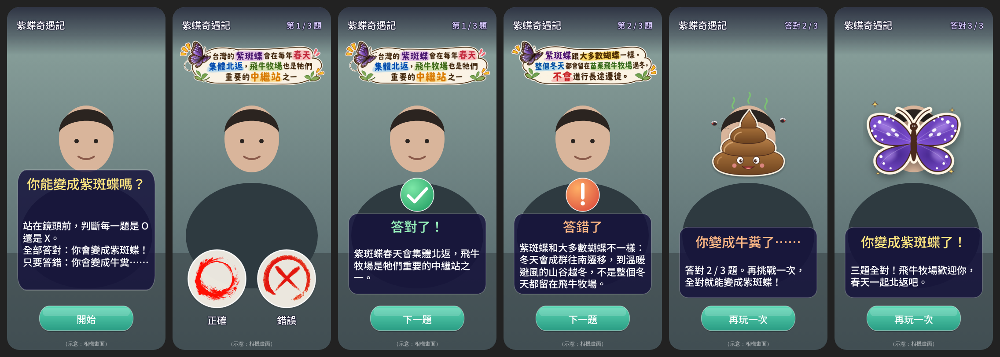

# 紫蝶奇遇記 — Lens Studio 三題視訊遊戲

用手機鏡頭（視訊）玩的紫斑蝶是非題：**三題 O / X，全對就變成紫斑蝶，只要答錯就變成牛糞。**
題目是三張說明圖，答案用 O / X 圖片按鈕點選，答完後臉上會出現「紫斑蝶」或「牛糞」圖片。

（預覽圖用剪影代替相機畫面，是依同一份版面模擬的，實際字級與換行以 Lens Studio 為準。）

## 玩法
1. 開場說明 →「開始」
2. 三題是非題（依序）：
   - 台灣的紫斑蝶會在每年春天集體北返，飛牛牧場也是牠們重要的中繼站之一。 → **O**
   - 紫斑蝶跟大多數蝴蝶一樣，整個冬天都會留在苗栗飛牛牧場過冬，不會進行長途遷徙。 → **X**
   - 飛牛牧場內種植了許多紫斑蝶喜歡的蜜源與食草植物，因此常能觀察到牠們的蹤跡。 → **O**
3. 每題答完會顯示對錯與解說。
4. 三題全對 → 變成**紫斑蝶**；只要錯一題 → 變成**牛糞**（會顯示答對幾題）。「再玩一次」重來。

## 使用方式（Lens Studio 5.x）
1. 新建一個專案（預設的相機畫面就是視訊）。
2. 把整個 `Assets/PurpleButterfly` 資料夾拖進 Asset Browser（**保持資料夾結構**）。
3. Objects 面板按 `+` → **Screen Image**（會自動建立 Orthographic Camera 和一張圖片）。
4. 再按 `+` → **Scene Object**，改名 `Game`；在 Inspector 按 **Add Component → Script**，選 `GameController.js`；
   把第 3 步的 Screen Image 從 Objects 面板**拖到 Template Image 欄位**。
5. 在 Preview 切到手機直式測試（用前鏡頭自拍最合適）。

Template Image 只是用來借它的材質，腳本會把它隱藏。

## 變身圖片會跟著臉
腳本會嘗試用臉部追蹤把「紫斑蝶 / 牛糞」放在臉的位置並依臉的大小縮放。
如果找不到臉或無法建立臉部追蹤，就會放在畫面中間（Console 會有提示）。不想用可以在 Inspector 取消勾選「變身圖片跟著臉移動」。

## 內容
| 路徑 | 說明 |
|---|---|
| `Assets/PurpleButterfly/Scripts/QuizData.js` | 三題題目、答案、解說、結果文字 |
| `Assets/PurpleButterfly/Scripts/GameLogic.js` | 遊戲流程（純 JavaScript，可用 Node 測試） |
| `Assets/PurpleButterfly/Scripts/GameController.js` | 自動建立介面、處理點擊、臉部追蹤 |
| `Assets/PurpleButterfly/Art/q1~q3_banner.png` | 你提供的三張題目圖 |
| `Assets/PurpleButterfly/Art/ans_o.png`、`ans_x.png` | 你提供的 O / X 圖 |
| `Assets/PurpleButterfly/Art/img_butterfly.png`、`img_dung.png` | 我畫的「紫斑蝶」與「牛糞」貼紙（1024×1024，透明背景） |
| `Assets/PurpleButterfly/Art/ui_*.png`、`icon_*.png` | 按鈕、卡片、答對 / 答錯徽章 |
| `Assets/PurpleButterfly/Fonts/` | Noto Sans TC Medium 子集字型（SIL OFL 1.1，授權文字在同資料夾） |
| `tools/` | 圖片產生與預覽程式（只重畫我畫的圖，不會動你的圖） |
| `tests/run-tests.js` | 自動測試：`node tests/run-tests.js` |

## 修改
- 改題目：把新的題目圖放進 `Art/`，再改 `QuizData.js` 的 `banner`、`answer`（`true` = O、`false` = X）、`explain`。改完執行 `node tests/run-tests.js`。
- 換變身圖：用同檔名取代 `img_butterfly.png` / `img_dung.png`。
- 版面：`GameController.js` 的 `R` 物件，數字是螢幕比例（左上為 0,0）。
- 字型只含常用繁體字，加了生僻字會顯示成方框，請換成完整字型並拖到 GameController 的「字型」欄位。

## 還沒在 Lens Studio 裡實測的地方
我沒有 Lens Studio 可以測試。腳本用的 API 參照 Snap 官方範例，點擊流程與臉部追蹤的程式邏輯用模擬環境測過，但沒有在真正的 Lens Studio 跑過。遇到問題時：

| 狀況 | 處理 |
|---|---|
| Console 顯示「找不到資源」 | 確認有拖整個資料夾進去，且資料夾名稱沒改 |
| 中文變成方框 | 把 `Fonts/NotoSansTC-Medium-subset.ttf` 拖到 GameController 的「字型」欄位 |
| 沒有相機畫面 | 確認場景裡有預設的 Camera Object（新專案都有），且沒有其他全螢幕圖片擋住 |
| 變身圖片沒跟著臉 | 取消「變身圖片跟著臉移動」，圖片會固定放在畫面中間 |
| 文字沒有自動換行或縮小 | 到 `PurpleButterfly UI` 底下的 Text，把 Overflow 設成 Wrap / Shrink |
| 點了沒反應 | 確認 Preview 是手機直式，Template Image 在 Orthographic Camera 底下 |

## 內容要查證
- 三題的對錯與解說是依你提供的題目圖整理：第 1、3 題為 O，第 2 題為 X（紫斑蝶冬天會成群往南遷移到溫暖避風的山谷越冬）。解說文字請導覽人員或生態專家確認。
- 蝴蝶與牛糞貼紙是原創插畫，沒有使用外部素材。
